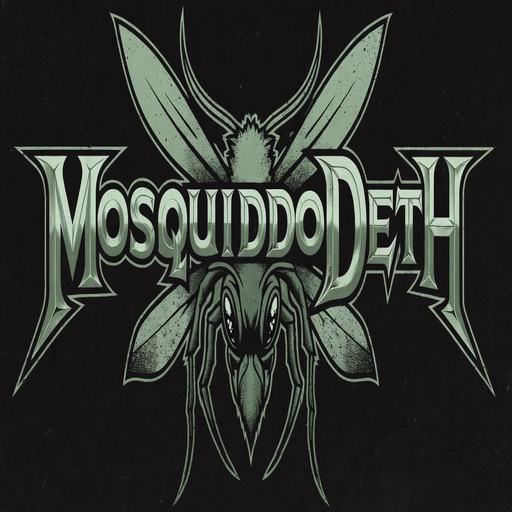

<p align="center">
  
</p>

<h1 align="center">MosquiddoDeth</h1>

<p align="center"><em>Death from above, on a schedule.</em></p>

<p align="center">
  An ESP32 multi-zone mosquito-misting controller with a phone-first web UI —
  scheduling, rain delay, tank monitoring, and over-the-air updates.
</p>

<p align="center">
  
  
  
  
  
</p>

---

## What it is

A self-hosted misting-system brain. Flash it to an ESP32 wired to a relay board, and it
drives up to eight spray zones on independent schedules — no cloud account, no app store.
The entire interface is a web app served straight off the device, tuned for a phone held
one-handed in the backyard.

## Features

- **Multi-zone** — up to 8 relay-driven spray lines (4 out of the box), each named, timed, and scheduled on its own.
- **Scheduling** — per-zone day/time schedules kept honest by NTP, with timezone and DST handling.
- **Rain delay** — pause scheduled runs for a set window so you're not misting a yard that's already soaked.
- **Tank monitoring** — a JSN-SR04T ultrasonic sensor reports fill level and warns before you spray an empty tank.
- **PIN lock** — an optional 4-digit PIN gates every control action.
- **Phone-first web UI** — served from on-device LittleFS, installable to the iOS home screen as a web app.
- **Peer discovery** — multiple units find each other over UDP + mDNS and roll up into one "All Sprayers" view.
- **Captive-portal setup** — hold the button for 5s to launch a setup AP; join your Wi-Fi from a phone. No credentials in source.
- **OTA updates** — devices poll for new firmware and update themselves.

## Hardware

| Function | ESP32 GPIO | Notes |
|---|---|---|
| Zone relays 1–4 | 26, 25, 33, 32 | one relay per spray line (expandable to 8 zones) |
| Manual button | 27 | tap to cycle zones · hold 5s to enter setup |
| Status LED | 2 | onboard LED |
| Tank sensor TRIG / ECHO | 14 / 12 | JSN-SR04T waterproof ultrasonic |

You supply the ESP32 dev board, a relay module, and the pump/solenoids for your misting
lines. The wiring is captured in [`wiring-diagram.drawio`](wiring-diagram.drawio).

## Build & flash

Built with [PlatformIO](https://platformio.org/) (board `esp32dev`, Arduino framework).
Dependencies — ESPAsyncWebServer, AsyncTCP, ArduinoJson 7 — install automatically.

```bash
pio run -t upload      # flash the firmware
pio run -t uploadfs    # flash the web UI (the data/ folder → LittleFS)
pio device monitor     # serial console @ 115200
```

## First run

1. Power on and **hold the button for 5 seconds** — the device starts a `MosquiddoDeth-Setup-xxxx` access point with a captive portal.
2. Connect to it from your phone, pick your Wi-Fi network, and enter the password.
3. It reboots onto your network. Reach it at **`http://mosquiddo-deth-xxxx.local`** (the suffix is the last 4 of the device MAC).

## Develop the UI without hardware

A mock of the device API lets you work on the web interface from your laptop:

```bash
python3 mock-server.py          # serves the UI + fake device state
python3 mock-server.py --setup  # simulate first-run setup mode
```

## Layout

```
src/main.cpp            firmware
data/                   web UI served from LittleFS (index.html, icons, logo)
include/config.h        pins, zone count, spray + tank defaults, timezone
mock-server.py          local mock of the device API for UI work
platformio.ini          build configuration
wiring-diagram.drawio   wiring reference
version.json            OTA manifest (version + firmware URL)
```

## License

MIT — see [LICENSE](LICENSE).

